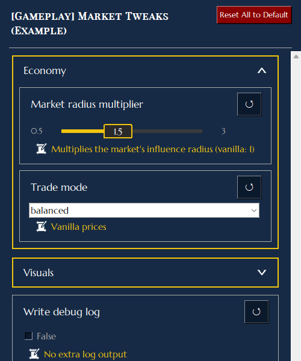
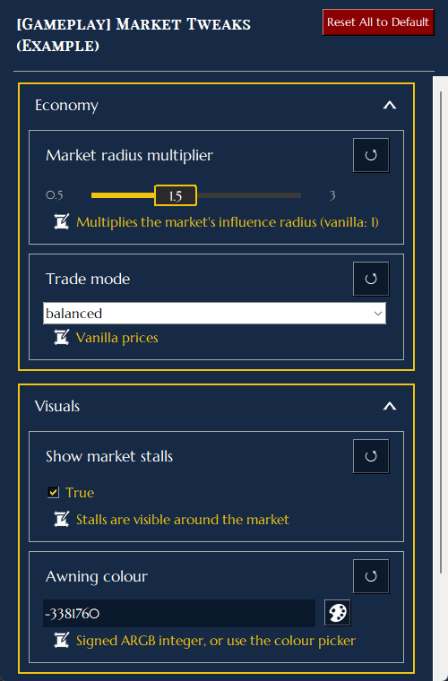
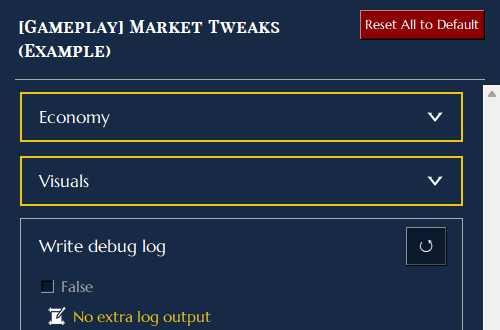

# Anno 117 Mod Manager


Dieses Projekt steht in keiner Verbindung zu Ubisoft und/oder mod.io und wird von diesen auch nicht unterstützt.

---

Eine Desktop-Anwendung zur Verwaltung von Mods für **Anno 117: Pax Romana**. Sie deckt den gesamten Mod-Workflow ab – Mods aktivieren und sortieren, im [mod.io](https://mod.io/g/anno-117-pax-romana) stöbern und Mods installieren, kuratierten Kollektionen folgen, Mod-Optionen anpassen und den Überblick über installierte Mods mit eigenen Presets behalten.

> Erstellt mit Python und Tkinter. Läuft unter Windows (als eigenständige `.exe`) und Linux (aus dem Quellcode).

---

## Inhaltsverzeichnis

- [Anno 117 Mod Manager](#anno-117-mod-manager)
  - [Inhaltsverzeichnis](#inhaltsverzeichnis)
  - [Voraussetzungen](#voraussetzungen)
  - [Installation](#installation)
    - [Windows - Eigenständige Executable](#windows---eigenständige-executable)
    - [Linux / Aus dem Quellcode](#linux--aus-dem-quellcode)
  - [Erster Start](#erster-start)
  - [Seitenleiste](#seitenleiste)
  - [Tabs](#tabs)
    - [News-Tab](#news-tab)
    - [Mod-Aktivierung-Tab](#mod-aktivierung-tab)
      - [Mod-Liste](#mod-liste)
      - [Sortieren \& Filtern](#sortieren--filtern)
      - [Rechtes Panel](#rechtes-panel)
      - [Presets](#presets)
    - [Mod-Browser-Tab](#mod-browser-tab)
      - [Suche \& Filter](#suche--filter)
      - [Mod-Kacheln](#mod-kacheln)
      - [Installationsablauf](#installationsablauf)
      - [Bewertung](#bewertung)
    - [Sammlungen-Tab](#sammlungen-tab)
      - [Einer Sammlung folgen](#einer-sammlung-folgen)
      - [Entfolgen](#entfolgen)
    - [Manuelle Installation-Tab](#manuelle-installation-tab)
    - [Modloader-Log-Tab](#modloader-log-tab)
    - [Tweaking-Tab](#tweaking-tab)
      - [Für Mod-Autoren: Optionen gruppieren](#für-mod-autoren-optionen-gruppieren)
    - [Einstellungen-Tab](#einstellungen-tab)
      - [Allgemein](#allgemein)
      - [Spieldateien](#spieldateien)
      - [Mod-Speicherort](#mod-speicherort)
      - [mod.io-Integration](#modio-integration)
      - [Unterdrückte Update-Prüfungen](#unterdrückte-update-prüfungen)
      - [Fußzeile](#fußzeile)
  - [Mod-Speicherorte](#mod-speicherorte)
  - [Presets](#presets-1)
  - [Ladereihenfolge](#ladereihenfolge)
  - [Lokalisierung](#lokalisierung)
    - [Bekannte Probleme](#bekannte-probleme)
  - [Fehlerbehebung](#fehlerbehebung)
  - [Support](#support)
  - [Credits](#credits)

---

## Voraussetzungen

| Abhängigkeit | Hinweise |
|---|---|
| Anno 117: Pax Romana | Das Spiel muss installiert sein |
| Python 3.11+ | Nur beim Ausführen aus dem Quellcode erforderlich |
| `pillow`, `requests`, `beautifulsoup4` | Python-Pakete (nur für Quellcode) |
| `tkinterdnd2` *(optional)* | Ermöglicht Drag-and-Drop-ZIP-Installation |

---

## Installation

### Windows - Eigenständige Executable

1. Lade die neueste `Anno117ModManager.zip` von der [Releases](../../releases)-Seite herunter.
2. Entpacke sie an einen beliebigen Ort – `Anno 117 Mod Manager.exe` und der danebenliegende `_internal`-Ordner gehören zusammen, also den entpackten Ordner intakt lassen.
3. Doppelklick auf `Anno 117 Mod Manager.exe` zum Starten. Keine Installation nötig.

### Linux / Aus dem Quellcode

**1. Python 3.10+ und die Tcl/Tk-Systembibliothek installieren** (Tkinter ist auf den meisten Distributionen nicht mitgeliefert):

- Arch / Manjaro: `sudo pacman -S tk`
- Debian / Ubuntu: `sudo apt install python3-tk`
- Fedora: `sudo dnf install python3-tkinter`

**2. Repository klonen und Python-Abhängigkeiten installieren:**

```bash
git clone https://github.com/taludas/anno-117-mod-manager.git
cd anno-117-mod-manager
pip install --user pillow requests beautifulsoup4 tkinterdnd2
python anno117-modmanager.py
```

Falls `pip install` mit einer *externally-managed environment*-Meldung (PEP 668) abbricht, entweder `--break-system-packages` ergänzen, die Abhängigkeiten aus dem Distributionspaketmanager installieren (z. B. `python-pillow python-requests python-beautifulsoup4` auf Arch — `tkinterdnd2` muss weiterhin per pip installiert werden) oder ein virtualenv verwenden:

```bash
python -m venv .venv
source .venv/bin/activate
pip install pillow requests beautifulsoup4 tkinterdnd2
python anno117-modmanager.py
```

Die App speichert ihre Einstellungen und Logs unter `~/.config/Anno 117 Mod Manager/` auf Linux. Anno 117 selbst läuft über Proton oder Wine. Der Mod Manager sucht das Spiel:

- in jeder Steam-Bibliothek (natives, Flatpak- und Snap-Steam, auch zusätzliche Bibliotheken auf anderen Laufwerken);
- im Ubisoft-Connect-Ordner jedes Wine-/Proton-Präfixes: Steam (Ubisoft Connect als Nicht-Steam-Spiel), Lutris, Heroic, Bottles, Faugus, PortProton und `~/.wine`;
- in eigenen Installationsordnern innerhalb dieser Präfixe.

Den spielinternen `Documents`-Ordner nimmt er aus demselben Präfix (`drive_c/users/<Benutzer>/Documents/`).

Wird das Spiel nicht gefunden, kannst du den Pfad unter **Einstellungen → Spiel-Dateien** selbst setzen: Klicke auf **Durchsuchen** oder füge den Pfad ins Feld ein und drücke Enter. Gemeint ist der Ordner `Anno 117 - Pax Romana` (der `Bin/Win64/Anno117.exe` enthält). Versteckte Ordner wie `.local` oder `.wine` werden in der Ordnerauswahl angezeigt; mit der Option „Show hidden“ lassen sie sich ein- und ausblenden. Wird dein Mods-Ordner ebenfalls nicht gefunden, setzt du den Documents-Ordner auf dieselbe Weise.

**Die Windows-`.exe` unter Wine/Proton** (z. B. als Nicht-Steam-Spiel, in Lutris oder Bottles) funktioniert ebenfalls. Die App erkennt, dass sie unter Wine läuft, und durchsucht dieselben Linux-Orte über Wines Laufwerk `Z:`, auch wenn das Spiel in einem anderen Präfix liegt. Ihre Ordnerauswahl startet in deinem Linux-Home und zeigt versteckte Ordner. Pfade kannst du in Linux-Form einfügen (`/home/<Benutzer>/...` oder `~/...`); sie werden automatisch in `Z:\home\<Benutzer>\...` übersetzt.

---

## Erster Start

Beim allerersten Start zeigt die App eine **Sprachauswahl** an, bevor irgendetwas anderes geladen wird. Wähle deine bevorzugte UI-Sprache und bestätige – die Auswahl wird gespeichert und kann später in den Einstellungen geändert werden.

Nach der Sprachauswahl wird die App:

1. **Anno 117 automatisch suchen** – sie durchsucht die Windows-Registry, Steam-Bibliotheksordner und gängige Installationspfade. Wenn das Spiel nicht gefunden wird, wirst du aufgefordert, das Installationsverzeichnis manuell auszuwählen.
2. **Anno 117 Dokumentenordner suchen** – auf den meisten Systemen ist das `~/Dokumente/Anno 117 - Pax Romana/`. Wenn dein Dokumentenordner an einen nicht-standardmäßigen Ort verschoben wurde, durchsucht die App alle Laufwerke und fordert dich auf, den richtigen Ordner anzugeben, wenn er nicht automatisch gefunden werden kann.
3. **Fragen, ob du die mod.io-Integration aktivieren möchtest** – das ist optional. Du kannst es jederzeit später in den Einstellungen aktivieren.

---

## Seitenleiste

Die linke Seitenleiste ist immer sichtbar und enthält:

- **Tab-Schaltflächen** – wechsle zwischen allen acht Bereichen der App.
- **Discord** – öffnet den Community-Discord-Server.
- **Ko-fi** – öffnet die Ko-fi-Seite des Entwicklers, wenn du die Entwicklung unterstützen möchtest.
- **Dokumentation** – öffnet diese Github-Readme mit Informationen zu den Funktionen der App.
- **SPIEL STARTEN** – speichert den aktuellen Mod-Status und startet Anno 117 über Ubisoft Connect oder Steam, sodass dort hinterlegte Startparameter (z. B. `/pipe` für Drittanbieter-Tools) übernommen werden. Lässt sich die Installation keinem der beiden Launcher zuordnen, wird die Spiel-exe direkt gestartet. Vor dem Start prüft die App, ob erforderliche Abhängigkeiten fehlen, und warnt dich, wenn aktive Mods ungelöste Inkompatibilitäten aufweisen.

---

## Tabs

### News-Tab

Fasst Neuigkeiten aus mehreren Quellen in einem einzigen Feed zusammen:

- **Anno Union** – offizielle Blogbeiträge des Anno-Entwicklungsteams.
- **mod.io neue Mods** – kürzlich veröffentlichte Mods für Anno 117.
- **mod.io Abonnement-Updates** – Updates zu Mods, die du **abonniert** hast (erfordert mod.io-Login).
- **Kollektions-Updates** – Änderungen an Kollektionen, denen du **folgst** (erfordert mod.io-Login).
- **Reddit r/anno** *(optional, in den Einstellungen aktivierbar)* – aktuelle Beiträge aus dem Anno-Subreddit.

Jede Karte zeigt das Quelle-Badge, Datum, Titel, Zusammenfassung und ein optionales Vorschaubild. Karten für mod.io-Einträge enthalten eine Schnellzugriff-Schaltfläche, um direkt zu diesem Mod im Mod-Browser oder Sammlungen-Tab zu springen.

News werden für die aktuelle Sitzung zwischengespeichert und nur neu abgerufen, wenn du auf **Neuigkeiten aktualisieren** klickst oder die App neu startest.

---

### Mod-Aktivierung-Tab

Der primäre Tab zum Verwalten, welche Mods beim Spielstart aktiv sind.

#### Mod-Liste

- Jeder installierte Mod erscheint als Zeile mit einer ✔️ **Checkbox** zum Aktivieren oder Deaktivieren.
- **Kategorie-Badge** – zeigt die Kategorie des Mods aus seiner `modinfo.json`.
- **Status-Icons** erscheinen vor dem Mod-Namen:

  | Icon | Bedeutung |
  |---|---|
  | ⚙ (Zahnrad) | Mod hat anpassbare Optionen — **Klick navigiert direkt zu diesem Mod im Tweaking-Tab** |
  | ✘ (rotes X) | Aktiver Inkompatibilitätskonflikt mit einem anderen aktivierten Mod |
  | ... (orangene drei Punkte) | Eine erforderliche Abhängigkeit ist nicht installiert |
  | ⏳️ (orangene Sanduhr) | Dieser Mod wurde durch einen anderen aktiven Mod ersetzt |
  | ⚙ (blaues mod.io logo) | Mod wurde aus dem Mod-Browser installiert — **Klick öffnet diesen Mod im Mod-Browser** |
  | **!** (gold, vor ⚙) | Die Versionsnummer in der lokalen `modinfo.json` des Mods stimmt nicht mit der auf mod.io angegebenen Version überein. **Linksklick** startet direkt den Update-Download. **Rechtsklick** öffnet ein Menü, um das Badge für diesen Mod dauerhaft zu unterdrücken – nützlich, wenn ein Mod-Autor die Versionsnummer in der `modinfo.json` nicht mit der Version auf mod.io synchronisiert hält und dadurch ein dauerhafter Fehlalarm entsteht. Unterdrückte Mods werden in den Einstellungen unter „Unterdrückte Update-Prüfungen” aufgelistet und können dort jederzeit zurückgesetzt werden. |

- Mod-Namen werden **rot** für Konflikte und **orange** für fehlende Abhängigkeiten oder Ersetzungen angezeigt.
- Sub-Mods (Unterordner innerhalb eines Mods) erscheinen eingerückt unter ihrem übergeordneten Mod und können nicht einzeln deinstalliert werden.
- Beim Start prüft die App im Hintergrund mod.io auf verfügbare Updates für alle abonnierten Mods. Das goldene **!**-Badge verschwindet, sobald du das Update installierst.

#### Sortieren & Filtern

- Klicke auf die Spaltenköpfe ✔️ / **Kategorie** / **Mod-Name** zum Sortieren. Kategorie unterstützt A→Z, Z→A und aus.
- Nutze die **Suchleiste**, um nach Name oder Kategorie zu filtern. Die Liste filtert beim Tippen, schon ab dem ersten Buchstaben.
- Wird ein Mod an- oder abgehakt, wandert er direkt in die Gruppe Aktiv bzw. Deaktiviert; der Rest der Liste bleibt, wo er ist.
- **↻ Aktualisieren** liest alle Mods neu von der Festplatte, misst die Ordnergrößen neu und aktualisiert die Warnungen zu fehlenden Abhängigkeiten und Konflikten. Nutze es, nachdem du Mod-Dateien außerhalb der App geändert hast, oder um die Warnungen nach dem An- und Abhaken zu aktualisieren.
- **Alle aktivieren** setzt das Profil zurück, sodass jeder installierte Mod aktiv ist.
- Der **Ladereihenfolge**-Schalter wechselt zu einer schreibgeschützten Ansicht, die die genaue Reihenfolge zeigt, in der das Spiel Mods lädt – berechnet aus den `LoadAfter`-Abhängigkeitsregeln in der `modinfo.json` jedes Mods.

#### Rechtes Panel

Ein Klick auf einen Mod öffnet sein Detailpanel auf der rechten Seite:

- Banner oder Vorschaubild (mit Platzhalter, wenn keines vorhanden ist).
- Version, Ersteller, Beschreibung.
- Schwierigkeitsmodifikator und Spiel-Setup-Flags (Neues Spiel erforderlich, Sicher zum Entfernen, Multiplayer-kompatibel, Kampagnen-sicher).
- Vollständige Abhängigkeitsliste – **Erfordert**, **Optional**, **Lädt nach**, **Ersetzt**, **Inkompatibel** – jeder Eintrag zeigt mit einem ✔ / ✘ / • an, ob er aktuell installiert ist.
- **Bekannte Probleme**-Bereich, wenn der Mod welche auflistet.
- Ordnerpfad und Dateigröße auf der Festplatte.
- **Ordner öffnen** – öffnet das Verzeichnis des Mods im Explorer / Dateimanager.
- **mod.io-Seite öffnen** *(nur mod.io-Mods)* – öffnet die mod.io-Seite des Mods im Browser.
- **↻ Neu installieren** *(nur mod.io-Mods)* – lädt die neueste Version von mod.io herunter und installiert sie neu. Erscheint links neben der Abonnement-beenden-Schaltfläche.
- **Mod deinstallieren** – löscht die lokalen Dateien nach Bestätigung. Warnt, wenn andere aktive Mods davon abhängen.
- **Abonnement beenden** *(nur mod.io-Mods)* – entfernt das mod.io-Abonnement und deinstalliert den Mod. Warnt, wenn andere aktive Mods davon abhängen.

#### Presets

Presets speichern und stellen deinen vollständigen Aktivierungsstatus wieder her (welche Mods an oder aus sind). Auf aktualisierten Spielversionen sind das die spieleigenen, nativen Mod-Profile – Details siehe [Presets](#presets-1) weiter unten.

- Das **Aktives Profil**-Dropdown oben listet alle gespeicherten Presets sowie zwei integrierte System-Presets auf:
  - **Keine Mods aktiv** — deaktiviert jeden installierten Mod mit einem Klick. Kann nicht gelöscht werden.
  - **Standard** — aktiviert jeden installierten Mod. Kann nicht gelöscht werden.
- **Speichern** – speichert den aktuellen Status direkt in das aktive Preset zurück. Die vorherige Version wird automatisch als `<Name>.bak` gesichert. Wird nur angezeigt, wenn ein benanntes Preset aktiv ist.
- **Als neu speichern** – speichert den aktuellen Status unter einem neuen Namen.
- **Löschen** – entfernt das ausgewählte Preset dauerhaft. System-Presets können nicht gelöscht werden.
- Kollektions-Presets werden automatisch erstellt, wenn du einer Kollektion folgst, und sind mit *(Kollektion)* gekennzeichnet.

---

### Mod-Browser-Tab

Stöbere und installiere Mods direkt von mod.io, ohne die App zu verlassen. Erfordert ein mod.io-Konto und einen API-Schlüssel (in den Einstellungen konfiguriert).

#### Suche & Filter

- **Suchleiste** – Volltextsuche im mod.io-Katalog. Ergebnisse werden ab drei Zeichen automatisch aktualisiert.
- **Sortierung** – Meiste Downloads, Alphabetisch, Neueste, Höchste Bewertung, Autor.
- **Tag-Filter** – Dropdown mit der Tag-Liste des Spiels von mod.io; nach einem einzelnen Tag filtern.
- **Abonniert**-Schalter – zeigt nur Mods an, die du aktuell abonniert hast.
- Die **✕**-Schaltfläche setzt gleichzeitig den Suchtext und den Tag-Filter zurück.

#### Mod-Kacheln

Jede Kachel zeigt das Mod-Vorschaubild, Name, Autor, Download-Anzahl, Bewertung und Dateigröße. Ein Klick auf eine Kachel öffnet das **Detail-Popup** mit der vollständigen Beschreibung, Galeriebildern und einer **Mod installieren**-Schaltfläche. Wenn du Mods auf mod.io außerhalb des Mod-Browsers abonniert hast, wird der Abonnementstatus automatisch synchronisiert, und ein goldenes „!“ warnt dich, falls du das Mod abonniert hast, aber keine lokale Kopie davon installiert ist. Installiere die Mod über die Schaltfläche ↻ Neu installieren neu, und die Warnung verschwindet. Das Gleiche gilt, wenn du den Mod über den Mod-Browser installiert und abonniert hast, das Abonnement aber außerhalb davon auf mod.io gekündigt hast – das „!“ fordert dich auf, das Abonnement erneut abzuschließen, um die neueste Version und Updates des Mods zu erhalten.

#### Installationsablauf

Ein Klick auf **Installieren** in einer Kachel oder im Detail-Popup:

1. Prüft erforderliche Abhängigkeiten und lädt sie zuerst herunter, falls sie fehlen – mit einem Fortschrittsfenster.
2. Lädt das Mod-Archiv in einen temporären Ordner herunter (wird nach der Installation automatisch bereinigt).
3. Entpackt und installiert die Mod in deinen konfigurierten Mod-Ordner.
4. Abonniert sie über deinen mod.io-Account, damit du zukünftige Updates im News-Feed erhältst.
5. Wechselt zum Aktivierungs-Tab — das mod.io-Icon (⚙) erscheint sofort neben dem Namen des neuen Mods.

Installierte Mods zeigen eine **↻ Neu installieren**-Schaltfläche (für Updates oder Dateireparatur) und eine **★ Abonniert**-Schaltfläche, die beim Hovern zu **Abonnement beenden** wird.

#### Bewertung

Du kannst einen Mod direkt von seiner Kachel aus **bewerten**, um dem Ersteller eine Bewertung auf mod.io zu geben. Das ist eine einmalige Aktion – nach der Bewertung bleibt die Schaltfläche deaktiviert.

---

### Sammlungen-Tab

Sammlungen sind kuratierte Mod-Kolektionen, die von der Community auf mod.io gepflegt werden.

- **Suchleiste** – Volltextsuche mit automatischen Ergebnissen ab drei Zeichen. Der **Tag-Filter** funktioniert genauso wie im Mod-Browser.
- Der **Gefolgt**-Schalter zeigt nur Sammlungen an, denen du folgst.
- Ein Klick auf eine Kachel öffnet ein **Detail-Popup** mit der Beschreibung der Sammlung, Tag-Liste und vollständiger Mod-Liste (jeder Mod ist ein anklickbarer Link zu seiner mod.io-Seite).

#### Einer Sammlung folgen

Ein Klick auf **Folgen** bei einer Sammlung:

1. Abonniert jeden Mod der Sammlung auf mod.io.
2. Lädt Mods herunter und installiert die, die noch nicht lokal vorhanden sind.
3. Erstellt ein **Sammlungs-Preset** im Aktivierungs-Tab mit diesen aktiven Mods und allen anderen deaktiviert.
4. Wechselt automatisch zum Aktivierungs-Tab, damit du das Ergebnis überprüfen kannst.

#### Entfolgen

Die **Entfolgen**-Schaltfläche gibt dir drei Optionen:

- **Entfolgen + Mods entfernen** – beendet Abonnements und löscht Mods, die nur zu dieser Sammlung gehören.
- **Entfolgen** – entfernt das Folgen, ohne lokale Dateien zu berühren.
- **Zurück** – bricht ab.

---

### Manuelle Installation-Tab

Für Mods, die außerhalb von mod.io bezogen wurden.

- **ZIP-Archiv auswählen** – öffnet einen Datei-Picker; wähle eine beliebige Mod-`.zip` aus, und die App entpackt und installiert sie.
- **Drag & Drop** – ziehe eine `.zip` direkt auf die Drop-Zone (erfordert `tkinterdnd2`).

Die App prüft, ob das Archiv eine `modinfo.json` enthält, fragt bei bereits vorhandenem Mod-Ordner nach einer Überschreibbestätigung und aktiviert den Mod optional sofort, je nach deinen Einstellungen.

---

### Modloader-Log-Tab

Zeigt die `mod-loader.log`-Datei an, die der Anno Mod Loader nach jedem Spielstart schreibt.

- Zeilen mit `ERROR` werden rot hervorgehoben.
- Zeilen mit `WARNING` werden gelb hervorgehoben.
- **Log aktualisieren** – lädt die Datei neu von der Festplatte.
- **Text in Zwischenablage kopieren** – kopiert das gesamte Log, nützlich zum Teilen von Bug-Reports auf Discord.

---

### Tweaking-Tab

Einige Mods legen in ihrer `modinfo.json` konfigurierbare Wertoptionen fest (Zahlen, Farbwerte, Schalter, Enum-Auswahlen usw.), wenn dies vom Autor eingerichtet wurde. Der Tweaking-Tab ermöglicht es dir, diese anzupassen, ohne Dateien manuell zu bearbeiten.

- Das linke Panel listet alle installierten Mods mit Optionen auf.
- Die Auswahl eines Mods zeigt seine Optionen im rechten Panel:
  - **Enum** – Dropdown mit vordefinierten Auswahlmöglichkeiten.
  - **Schalter** – Checkbox für boolesche Einstellungen.
  - **Schieberegler** – Bewegt den Schieberegler frei in festgelegten Schritten auf einen beliebigen Wert zwischen dem Minimal- und dem Maximalwert.
  - **Text / Farbe** – Freitexteingabe; Farboptionen enthalten eine Farbauswahl-Schaltfläche für bestimmte Mods.
- Änderungen werden in `active-options.jsonc` in deinem Mod-Ordner gespeichert und beim nächsten Spielstart angewendet.
- **Optionsgruppen** – Mod-Autoren können zusammengehörige Optionen in aufklappbare Abschnitte bündeln: Ein Eintrag mit `"type": "group"` (plus `label` und optional `"collapsed": true`) wird zur Abschnittsüberschrift, und jede Option mit `"group": "<Gruppenschlüssel>"` erscheint darin. Ein Klick auf die Überschrift klappt den Abschnitt auf oder zu; der Pfeil rechts zeigt, ob ein Abschnitt offen (▲) oder geschlossen (▼) ist. Gruppen dienen nur der Anzeige und werden nie in `active-options.jsonc` geschrieben. Ein Beispiel findest du unter [Für Mod-Autoren: Optionen gruppieren](#für-mod-autoren-optionen-gruppieren).
- **Auf Standard zurücksetzen** setzt die Optionen für den ausgewählten Mod zurück. **Alle auf Standard zurücksetzen** setzt jeden Mod auf einmal zurück.

#### Für Mod-Autoren: Optionen gruppieren

Optionen stehen im `Options`-Block deiner `modinfo.json`. Zum Gruppieren legst du pro Gruppe einen Eintrag an und verweist in jeder Option darauf:

| Schlüssel | Wo | Bedeutung |
|---|---|---|
| `"type": "group"` | Gruppeneintrag | Macht den Eintrag zur Abschnittsüberschrift statt zu einer Option. |
| `"label"` | Gruppeneintrag | Text der Überschrift. Fehlt er, wird der Schlüssel der Gruppe angezeigt. |
| `"collapsed"` | Gruppeneintrag | `true` zeigt den Abschnitt anfangs zugeklappt. Standard: `false` (aufgeklappt). |
| `"group"` | Option | Schlüssel der Gruppe, zu der die Option gehört. |

Beispiel:

```json
"Options": {
  "economy": {
    "type": "group",
    "label": "Economy"
  },
  "visuals": {
    "type": "group",
    "label": "Visuals",
    "collapsed": true
  },
  "marketRadius": {
    "group": "economy",
    "label": "Market radius multiplier",
    "type": "slider",
    "default": "1.5",
    "values": ["0.5", "3", "0.1"],
    "labels": ["Multiplies the market's influence radius (vanilla: 1)"]
  },
  "tradeMode": {
    "group": "economy",
    "label": "Trade mode",
    "type": "enum",
    "default": "balanced",
    "values": ["cheap", "balanced", "expensive"],
    "labels": ["Goods are 25% cheaper", "Vanilla prices", "Goods are 25% more expensive"]
  },
  "showStalls": {
    "group": "visuals",
    "label": "Show market stalls",
    "type": "toggle",
    "default": "true",
    "labels": ["Stalls are visible around the market", "Market square stays empty"]
  },
  "awningColour": {
    "group": "visuals",
    "label": "Awning colour",
    "type": "text",
    "default": "-3381760",
    "labels": ["Signed ARGB integer, or use the colour picker"]
  },
  "debugLog": {
    "label": "Write debug log",
    "type": "toggle",
    "default": "false",
    "labels": ["Extra entries are written to mod-loader.log", "No extra log output"]
  }
}
```

Wird der Mod ausgewählt, ist *Economy* aufgeklappt und *Visuals* wegen `"collapsed": true` zugeklappt. `debugLog` hat kein `group` und steht deshalb einzeln unter den Gruppen:



Ein Klick auf die Überschrift *Visuals* klappt sie auf:



Sind beide Gruppen zugeklappt, bleiben nur die Überschriften und die ungruppierte Option sichtbar:



Hinweise:

- Gruppen erscheinen in der Reihenfolge, in der sie in `Options` stehen, und immer **über** den ungruppierten Optionen. Optionen innerhalb einer Gruppe behalten ihre Reihenfolge.
- `collapsed` legt nur den Anfangszustand fest. Wird der Mod erneut ausgewählt, gilt wieder dieser Zustand.
- Verweist `group` auf einen Schlüssel, der kein Gruppeneintrag ist, wird die Option ungruppiert angezeigt.
- Gruppeneinträge sind keine Optionen. Sie haben keinen Wert und werden nie in `active-options.jsonc` geschrieben.
- Gruppen-Labels sind einfache Texte. Anders als `ModName` werden sie nicht je Sprache übersetzt.

---

### Einstellungen-Tab

Der Einstellungen-Tab ist scrollbar — nutze das Mausrad oder die Scrollleiste rechts, um alle Bereiche zu erreichen.

#### Allgemein

- **Sprache** – ändere die UI-Sprache. Wirkt sofort, aber ein Neustart wird empfohlen.
- **Tutorial-Infotipps** – aktiviert/deaktiviert Hover-Tooltips in der gesamten App.
- **r/anno-Beiträge im News-Feed anzeigen** – schließt Reddit-Beiträge in den News-Tab ein.
- **Neu installierte Mods automatisch aktivieren** – Dropdown mit drei Optionen:
  - *Immer aktivieren* — neu installierte Mods werden sofort aktiviert.
  - *Immer deaktivieren* — Mods werden der Liste hinzugefügt, aber deaktiviert gelassen.
  - *Aktuellen Status beibehalten* — war der Mod bereits aktiv (z.B. bei einer Neuinstallation), bleibt er aktiv; andernfalls bleibt er deaktiviert.
- **Zum Tab „Mod-Aktivierung“ springen** – standardmäßig aktiviert – Wenn diese Option aktiviert ist, springt die App nach der Installation einer Mod/einer Sammlung zum Tab „Mod-Aktivierung“, wobei der neu installierte Mod bzw. die Mod-Sammlung bereits ausgewählt ist. Deaktiviere diese Option, damit nach der Installation über den „Mod-Browser“ oder „Sammlungen“ kein Tab-Wechsel erfolgt.

#### Spieldateien

- **Anno 117-Installationsverzeichnis** – manuell festlegen, wenn die automatische Erkennung fehlgeschlagen ist. Du kannst den Spielordner auf jeder Ebene auswählen — der übergeordnete Ordner von `Anno 117 - Pax Romana`, der Ordner selbst oder der innere `mods`-Unterordner funktionieren alle korrekt.
- **Anno 117 Dokumentenordner (Override)** – nur nötig, wenn dein Windows-Dokumentenordner an einen nicht-standardmäßigen Ort verschoben wurde. Navigiere zu deinem `Documents/Anno 117 - Pax Romana`-Ordner. Die **Löschen**-Schaltfläche ist deaktiviert, wenn kein Override gesetzt ist.

#### Mod-Speicherort

Wähle, wo die App Mods installiert:

| Modus | Pfad |
|---|---|
| **Benutzerdokumente** | `~/Documents/Anno 117 - Pax Romana/mods/` |
| **Spielverzeichnis** | `<Spielinstallation>/Anno 117 - Pax Romana/mods/` |

#### mod.io-Integration

- **API-Schlüssel** – füge deinen persönlichen API-Schlüssel von [mod.io → API-Schlüssel](https://mod.io/me/access) ein. Erforderlich für den Mod-Browser und den Kollektionen-Tab.
- **Verbinden / Trennen** – authentifiziere dich per E-Mail oder widerrufe deine Sitzung.
- Die Authentifizierung verwendet einen einmaligen E-Mail-Code-Flow und speichert einen 1-Jahr-gültiges Zugriffstoken lokal. Es wird nie ein Passwort gespeichert.

#### Unterdrückte Update-Prüfungen

Listet alle Mods auf, bei denen das **!**-Badge per Rechtsklick dauerhaft unterdrückt wurde. Die Schaltfläche **Alle löschen** entfernt alle Unterdrückungen und führt die Versionsprüfung sofort erneut aus.

#### Fußzeile

- **Konfigurationsordner öffnen** – öffnet das Datenverzeichnis der App (`%APPDATA%\Anno 117 Mod Manager` unter Windows, `~/.config/Anno 117 Mod Manager` unter Linux).
- **Debug-Log anzeigen** – öffnet `debug.log`, nützlich beim Melden von Problemen.

---

## Mod-Speicherorte

Die App speichert ihre eigenen Daten unter:

| Plattform | Pfad |
|---|---|
| Windows | `%APPDATA%\Anno 117 Mod Manager\` |
| Linux | `~/.config/Anno 117 Mod Manager/` |

Dort gespeicherte Dateien:

| Datei | Zweck |
|---|---|
| `settings.json` | Alle App-Einstellungen |
| `active-profile.txt` *(ältere Spielversionen)* | Welche Mods aktiv sind – wird in deinen Mod-Ordner geschrieben, nicht hierher. Neuere Spielversionen verwenden stattdessen `profile.txt` + `profiles/` – siehe [Presets](#presets-1) |
| `presets/` *(ältere Spielversionen)* | Gespeicherte Aktivierungs-Presets. Neuere Spielversionen speichern Profile direkt in `mods/profiles/` |
| `endorsements.json` | Lokal zwischengespeicherte Bewertungsstatus |
| `subscriptions.json` | mod.io-Abonnementliste |
| `subscription_map.json` | Ordnet lokale Mod-IDs mod.io-IDs zu |
| `collection_follows.json` | Gefolgte Kollektionen |
| `reddit_cache.json` | Zuletzt geladene r/anno-Beiträge, die genutzt werden, wenn Reddit den Feed drosselt |
| `debug.log` | Fortlaufendes Debug-Log (max. 2 MB, automatisch als `.bak` archiviert) |

---

## Presets

Ein Preset ist ein Schnappschuss deines Aktivierungsstatus – jeder Mod und ob er an oder aus ist.

Neuere Versionen von Anno 117 haben native Unterstützung für mehrere Profile im Mod Loader eingeführt: Mod-Profile liegen als einzelne Dateien in `mods/profiles/`, und `mods/profile.txt` hält fest, welches davon gerade aktiv ist. Der Mod Manager wurde daran angepasst – jedes Preset, das du hier speicherst oder lädst, **ist** ein echtes, umschaltbares Spielprofil und keine Kopie, die die App nur nebenbei verwaltet. Die Auswahl eines Presets in der App bestimmt direkt, welches Profil das Spiel beim nächsten Start lädt.

- Preset-Dateien liegen in `profiles/` innerhalb deines konfigurierten Mod-Ordners (siehe [Mod-Speicherort](#mod-speicherort)) und können wie bisher manuell geteilt, gesichert oder bearbeitet werden.
- Jedes Profil erhält einen `DisplayName`-Eintrag passend zu dem Namen, den du ihm in der App gegeben hast, damit es später auch im spieleigenen Profilwechsler korrekt angezeigt wird, sobald dieser erscheint.

Zwei System-Presets sind immer verfügbar und können nicht gelöscht werden:

- **Keine Mods aktiv** — deaktiviert jeden installierten Mod.
- **Standard** — aktiviert jeden installierten Mod.

Wenn du einer Sammlung folgst, wird automatisch ein Preset namens `<Sammlungsname> (Sammlung)` erstellt.

> **Noch auf einer älteren Spielversion?** Falls dein Mod-Ordner den Unterordner `mods/profiles/` noch nicht besitzt, greift die App automatisch auf die klassische einzelne Datei `active-profile.txt` zurück und speichert benannte Presets stattdessen in ihrem eigenen `presets/`-Ordner (siehe [Mod-Speicherorte](#mod-speicherorte)) – du musst nichts einstellen, es funktioniert in beiden Fällen automatisch. Sobald die App das neue Format erkennt, werden bereits gespeicherte Presets einmalig automatisch übernommen, damit nichts verloren geht.

---

## Ladereihenfolge

Die Ladereihenfolge bestimmt die Reihenfolge, in der das Spiel Mod-Patches anwendet. Die App berechnet sie genauso wie der Mod Loader:

1. **Normale Phase, dann späte Phase** – Mods mit `"*"` in `LoadAfter` laden nach allen anderen. `LoadAfter`-Einträge gelten nur innerhalb derselben Phase; nicht installierte Mods werden übersprungen.
2. **Sub-Mods zuerst** – innerhalb einer Phase werden Sub-Mods (Ordner mit eigener `modinfo.json` innerhalb eines Mods) vor den Hauptmods verarbeitet. Jede Gruppe wird alphabetisch nach `[Kategorie] ModName` sortiert, anhand der englischen Texte.
3. **Abhängigkeiten zuerst** – bevor ein Mod lädt, werden die Mods aus seinem `LoadAfter` geladen, in der dort angegebenen Reihenfolge.

Sub-Mods werden einzeln sortiert, daher können sich Sub-Mods verschiedener Mods abwechseln, und ein Hauptmod selbst lädt meist erst nach allen Sub-Mods. Aktiviere die **Ladereihenfolge**-Ansicht im Aktivierungs-Tab-Header, um die Reihenfolge zu sehen: Jeder Mod und Sub-Mod erhält eine eigene Zeile, durchnummeriert ab 1 in Ladereihenfolge, und Sub-Mod-Zeilen zeigen an, zu welchem Mod sie gehören.

---

## Lokalisierung

Die App wird mit Unterstützung für alle In-Game-Sprachen geliefert. Die UI-Sprache wird beim ersten Start ausgewählt und kann jederzeit in den Einstellungen geändert werden.

| Sprache | Datei |
|---|---|
| English | `texts_english.xml` |
| Deutsch | `texts_german.xml` |
| Français | `texts_french.xml` |
| Español | `texts_spanish.xml` |
| Italiano | `texts_italian.xml` |
| Polski | `texts_polish.xml` |
| Русский | `texts_russian.xml` |
| Português (Brasil) | `texts_brazilian.xml` |
| 日本語 | `texts_japanese.xml` |
| 한국어 | `texts_korean.xml` |
| 简体中文 | `texts_simplified_chinese.xml` |
| 繁體中文 | `texts_traditional_chinese.xml` |

Übersetzungsdateien befinden sich in `data/base/config/gui/`. Um eine Übersetzung hinzuzufügen oder zu korrigieren, kopiere `texts_english.xml`, übersetze die `<Text>`-Werte (lasse `<LineId>` unverändert) und benenne die Datei entsprechend.

### Bekannte Probleme

Die Lokalisierung wurde von mir für alle HAUPT-App-Fenster geprüft. Besonders bei Pop-up/Alert/Warn/Fehler-Fenstern kann es gut sein, dass lokalisierter Text zu lang für ein Fenster oder einen Button-Bereich ist. Wenn du solche Fehler bemerkst, versuche, das Fenster größer zu ziehen. Bitte öffne ein Issue mit einem Screenshot für jedes Vorkommnis, damit ich sie nach und nach beheben kann. Gleiches gilt für Rechtschreib-/Grammatikfehler – bitte unterstütze mich dabei, die App vollständig zu lokalisieren – alle Lokalisierungen außer Englisch und Deutsch wurden mit DeepL erstellt.

---

## Fehlerbehebung

**Die App kann Anno 117 nicht finden**
Gehe zu Einstellungen → Spieldateien → Durchsuchen und zeige auf den Installationsordner des Spiels. Du kannst auf jeder Ebene auswählen — der übergeordnete Ordner, `Anno 117 - Pax Romana` selbst oder der innere `mods`-Unterordner funktionieren alle.

**Die App kann meinen Dokumentenordner nicht finden**
Wenn dein Windows-Dokumentenordner an einen anderen Ort verschoben wurde (z.B. auf ein anderes Laufwerk), durchsucht die App automatisch alle Laufwerke. Wenn das fehlschlägt, nutze das Feld **Anno 117 Dokumentenordner (Override)** in Einstellungen → Spieldateien, um direkt auf deinen `Documents/Anno 117 - Pax Romana`-Ordner zu zeigen.

**Mods werden im Spiel nicht geladen**
Prüfe dein Modloader-Log und auch dein aktives Profil im `~/Documents/Anno 117 - Pax Romana/mods/`-Ordner – entweder direkt die `active-profile.txt`, oder, bei neueren Spielversionen, die Datei, auf die `mods/profile.txt` verweist, innerhalb von `mods/profiles/`. Wenn dort ein **#** vor dem Mod oder ein **# not installed** dahinter steht, lädt das Spiel den Mod nicht. Schau nochmal im Aktivierungs-Tab nach oder frage im Modding-Discord um Hilfe.

**Ein Mod erscheint überhaupt nicht in der Mod-Liste**
Die App toleriert übliche Formatierungsprobleme in der `modinfo.json` eines Mods – nicht-UTF-8-Textkodierungen (z. B. bei Mods mit chinesischen Zeichen), eine UTF-8-Byte-Order-Mark und überzählige Kommas werden automatisch behandelt. Erscheint ein Mod trotzdem nicht, prüfe das Debug-Log unter Einstellungen → Debug-Log anzeigen nach einer Zeile, die mit „Error parsing" beginnt – sie nennt die genaue Datei und den JSON-Fehler, den du dem Mod-Autor melden oder einem GitHub-Issue beifügen kannst.

**Der Mod-Browser / Kollektionen-Tab ist ausgegraut**
Diese Tabs erfordern einen mod.io-API-Schlüssel. Gehe zu Einstellungen → mod.io-Integration, gib deinen Schlüssel ein und verbinde deinen Account. Manchmal ist die mod.io-API nicht erreichbar – versuche es dann später nochmal oder starte die App neu.

**Ein Mod zeigt eine Warnung wegen fehlender Abhängigkeit**
Der Mod listet in seiner `modinfo.json` einen anderen Mod als harte Anforderung auf, der nicht installiert ist. Installiere zuerst die Abhängigkeit oder nutze die **Fehlende aktivieren**-Schaltfläche im Abhängigkeits-Dialog.

**Ein aus dem Browser installierter Mod zeigt kein mod.io-Icon / zeigt Deinstallieren statt Abonnement beenden**
Das kann passieren, wenn der Name des Mods auf mod.io erheblich vom Namen in seiner `modinfo.json` abweicht. Die App versucht mehrere Fuzzy-Matching-Strategien, um die beiden zu verknüpfen. Wenn es dauerhaft fehlschlägt, öffne bitte ein Issue mit dem Mod-Namen.

**Etwas ist schiefgelaufen und die App verhält sich komisch**
Prüfe das Debug-Log unter Einstellungen → Debug-Log anzeigen. Es erfasst alle `print`-Ausgaben und Ausnahmen der aktuellen Sitzung. Öffne ein Issue und hänge dein Log mit einer Beschreibung an, was du getan hast, um es zu reproduzieren.

---

## Support

- **Discord** – trete über die Schaltfläche in der App-Seitenleiste oder [diesen Link](https://discord.gg/m4e7ZanMVp) bei und stelle deine Frage in #Taludas' Mods im Feedback-Forum
- **Ko-fi** – [unterstütze den Entwickler](https://ko-fi.com/W7W8L558T)
- **Issues** – öffne ein GitHub-Issue und hänge dein `debug.log` an

---

## Credits

- Jakob Harder für seine anhaltende Arbeit und Dokumentation am [Anno Mod Loader](https://jakobharder.github.io/anno-mod-loader), der ursprünglich von Meow geschrieben und veröffentlicht wurde.
- Claude und Google Gemini für die eigentliche Arbeit – große Teile des Codes wurden mit Hilfe von KI geschrieben.
- Der Anno Mod Discord für seine Unterstützung und Hilfe.
